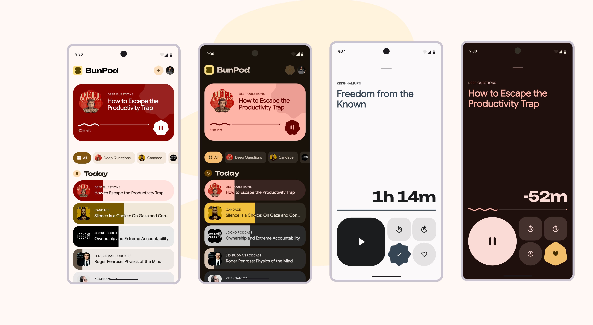

  

<h1 align="center">BunPod</h1>

  An open-source podcast player — Flutter and Material 3 Expressive!

  <a href="https://testflight.apple.com/join/B7jS52wZ">App Store</a> · <a href="https://play.google.com/store/apps/details?id=app.bunpod">Google Play</a> · <a href="https://bunpod.app">Website</a>

---

## Features

- 🎨 Every show gets its own color scheme, across the whole app
- 🫧 Springy, squishy buttons with haptics
- 〰️ Wavy progress and shape-morphing controls
- 🔎 Search and explore shows
- 🔖 Resume any episode where you left off
- 🔒 Lock screen controls
- 📦 OPML import and export
- 🌗 Light and dark themes
- 🙅 No account, your library is stored on your device
- ✈️ Offline listening (coming soon)

## Material 3 Expressive, before Flutter shipped it

I built BunPod before Flutter shipped Material 3 Expressive, so its shapes, springs, wavy progress, sheets, snackbars and loaders live in standalone packages in [`packages/`](packages). Take them and use them in your own apps.

Some build on the excellent work of Kostia Sokolovskyi.

## Run it

[DEVELOPMENT.md](DEVELOPMENT.md)

## License

[Apache 2.0](LICENSE)

---

<i>Want this level of detail in your Flutter app? <a href="https://kamranbekirov.com" target="_blank" rel="noopener">Let's work together</a></i>

